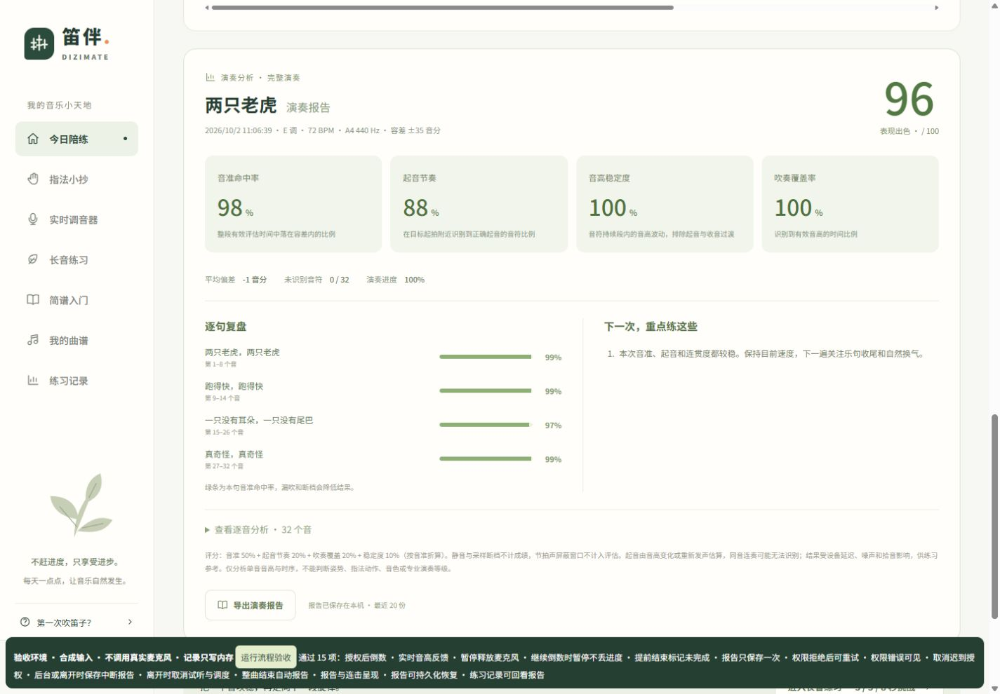
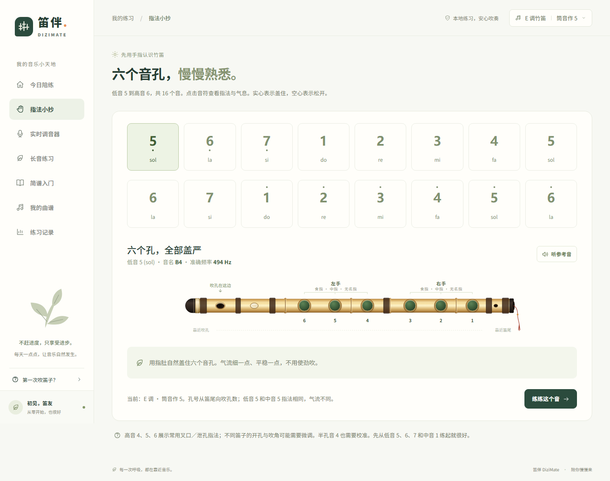
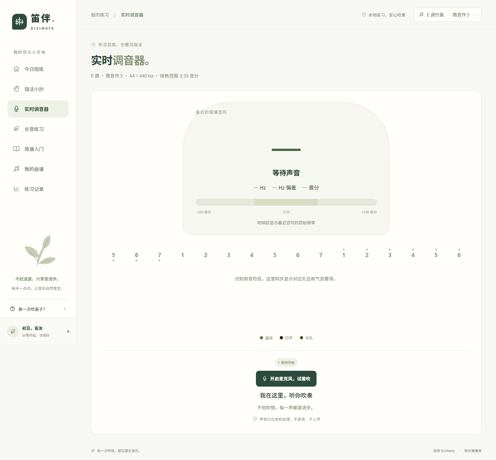
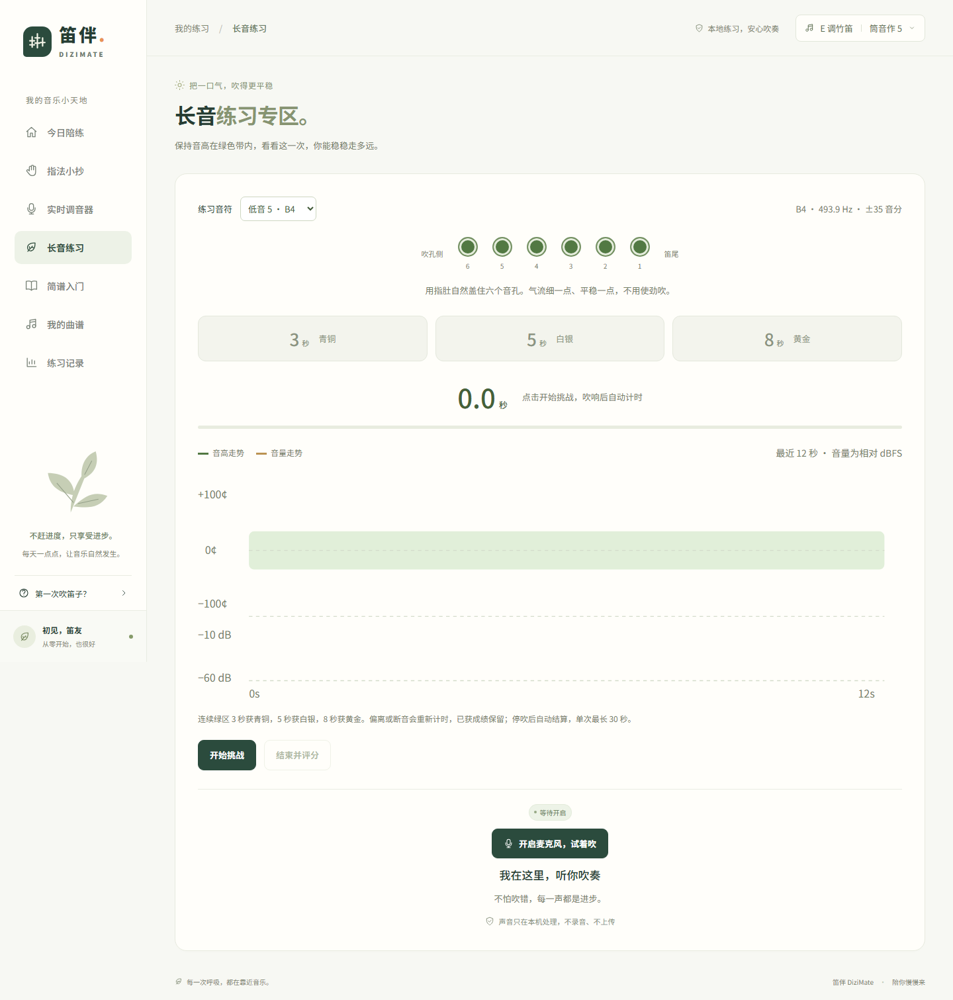
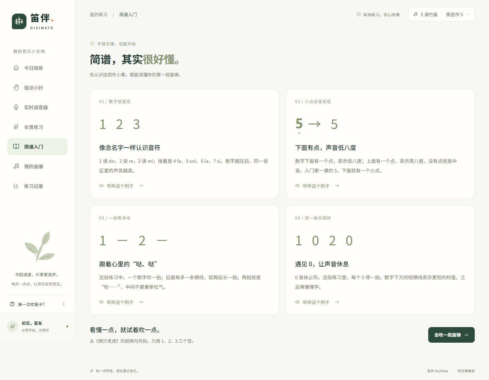
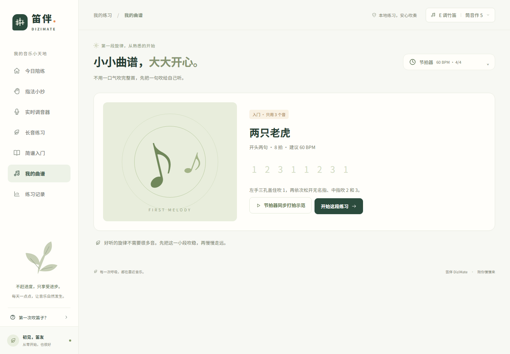
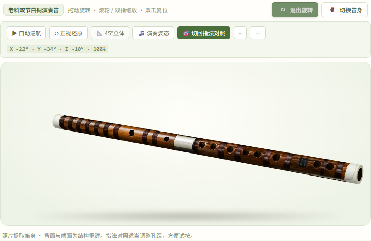

# 笛伴 DiziMate

面向竹笛零基础用户的 Web 练习台：看指法 → 听参考音 → 试着吹 → 获取音高反馈。默认 **E 调竹笛、筒音作 5**，无需账户。

## 主要页面截图

以下截图来自当前版本的桌面端页面，音高与练习数据处于未开启麦克风的初始状态。

### 今日陪练


跟曲演奏完成后自动生成报告，以下为合成输入的验收示例：



| 指法小抄 | 实时调音器 |
| --- | --- |
|  |  |
| 长音练习 | 简谱入门 |
|  |  |
| 我的曲谱 | 练习记录 |
|  |  |

## 运行

### 笛身旋转展示



鼠标或单指拖动旋转，滚轮或双指缩放；双指扭转或 Shift + 拖动可改变笛身倾斜方向。也可使用自动巡航、预设角度、正视还原，或切回六孔指法对照。完整照片资产位于 `public/flute-double-cutout.png`、`public/flute-single-cutout.png`，由内置图像工具按「透明抠图、移除支架、横向摆正、保留竹纹缠线和原有音孔」的要求清理。

### 本地启动

Node.js 20.19+ 或 22.12+。

```sh
npm install
npm run dev
```

打开终端显示的 localhost 地址（默认 http://localhost:5173）。麦克风需要 **localhost 或 HTTPS**；手机通过普通 HTTP 局域网 IP 访问时不能使用麦克风。

```sh
npm test
npm run build
npm run preview
```

`dist/` 可部署到任意 HTTPS 静态站点。页面使用原生 JavaScript、CSS、Web Audio API 和 Vite，无运行时第三方依赖、远程字体或后端服务。

## 第一遍怎么练

1. 在右上角确认 **E 调**，检查笛膜已贴好。
2. 看六孔指法图：实心盖住、空心松开；图中吹孔在左，孔号从笛尾向吹孔依次是 1–6。
3. 点击“听听这个音”。这是合成的音高参考，不是竹笛音色录音。
4. 点击“开始陪练”，选择 3 分钟、5 分钟或自由练习；开启麦克风，将设备放在笛子前方约 30–50 cm，避开直接气流。
5. 六孔盖严，轻轻吹低音 5；E 调的目标是 B4，约 **493.88 Hz**。音高多数时间落在绿区，音准信心积满后会显示“吹对啦”；偶尔的微颤只会扣减少量进度。
6. 实时反馈会同时告诉你偏低/偏高的原因和下一步；吹响后自动计时，暂停后再次开启会从上次音符继续。完成后可继续练低音 6、7，或者《两只老虎》前两句。

## 已有能力

- 笛身展示：从提供的实物照片中提取并清理双节白铜笛、单节竹笛的透明素材；点击「自由旋转展示」进入立体展示，支持鼠标／单指拖动、滚轮／双指缩放、双指扭转、自动巡航、预设角度和复位。键盘方向键旋转，Shift + 左右键扭转，+/− 缩放，Home 复位；切回指法对照后继续点击音孔。
- 展示边界：素材经 AI 辅助抠图与边缘清理，并非逐像素无损提取。立体展示使用本地 WebGL 圆柱笛身与照片纹理，背面和端面为结构重建，非实拍扫描模型；指法图调整孔距以便操作。不支持 WebGL 时降级为照片旋转，自动旋转在后台暂停，离开页面释放资源。
- 今日陪练：3/5 分钟或自由目标、当前步骤与实时计时、六孔图、目标音、合成参考音，以及包含方向/原因/动作的统一反馈状态。
- 跟曲演奏：在「今日陪练 → 实时陪练」切换到「跟曲演奏」，开始前显示曲目、速度、预计时长和耳机建议；选择《两只老虎》《小星星》完整旋律或《欢乐颂》完整主题，40–120 BPM 调速、完整参考旋律试听、4 拍倒数起音。滚动音高谱同时显示目标音符与实际音高，指法同步，逐音命中形成连击；可选节拍伴奏（建议戴耳机）。演奏台固定提供暂停、继续、结束，谱面绘制已节流；暂停释放麦克风，续吹重新倒数；整曲结束自动生成先给自然语言结论的报告，并显示与上次成绩对比和下次建议。
- 演奏报告：根据实际采样计算音准、起音节奏、持续段音高稳定度、有效吹奏覆盖、平均音分偏差，以及逐句／逐音分析和针对性建议。保留本机最近 20 份，在「练习记录」回看；可导出独立 HTML 报告，在浏览器中打印保存为 PDF。存储失败时可继续查看和导出，不上传声音。
- 指法小抄：低音 5–7、中音 1–7、高音 1–6，共 16 个音；上／下八度点、半孔、急吹与高音叉口／泄孔要领。孔位顺序统一为靠吹孔的 6 到笛尾的 1。高音区采用常用指法，不同竹笛可能需要微调。
- 实时调音器：支持自由调音和目标音模式；目标音可单独选择，低音／中音／高音分组展示，当前音符自动保持在可见区域。同步显示简谱、音名、实际 Hz、Hz 偏差和音分，并用指针、安全带及偏低／准确／偏高文字表达状态。
- 简谱入门：数字、八度点、延音线、休止符，附可播放的短示例。
- 曲谱：《两只老虎》前两句，逐音选择和节拍器同步打拍示范；练习面板与曲谱右上角都有可折叠节拍器，40–180 BPM，支持 2/4、3/4、4/4 和首拍重音。改变速度或拍号时，从第一拍重新同步。
- 长音专区：选择低音 5 到高音 6 任一音，点击开始挑战；3、2、1 倒计时后按吸气→吹奏→保持→收音阶段练习。双轨图显示最近 12 秒音高与相对音量，更新节奏已节流；连续绿区 3／5／8 秒分别获青铜／白银／黄金，并提示下一枚奖牌还差多少秒和偏离后的重计原因。停吹 0.6 秒、点击结束、达到黄金或单次达到 30 秒后生成本次得分。
- 设置：C/D/E/F/G 调、±20/35/50 音分容差、A4 430–450 Hz 校准。
- 本地记录：麦克风实际开启时长、吹准的不同音；保留最近 100 次，列表显示最近 20 次。关闭麦克风、切换页面、进入设置或页面转入后台时停止收音并保存。
- 适配桌面与手机，原生弹窗、键盘焦点、指法文字描述、减少动态效果支持。

## 音频与边界

只在用户点击后请求麦克风；音频仅经 Web Audio 在本机分析，不录制、不上传。播放参考音时暂停音高判定，避免把示范计作练习。离开页面或暂停时释放麦克风；未授权、设备缺失、设备占用或连接中断均提供提示。

输入链路为麦克风 → 150 Hz 二阶高通（Butterworth 响应）→ Analyser → YIN → 5 帧滑动中位数。中位数在对数频率域计算，抑制单帧跳八度；静音、切音、重启或示范时清空历史。检测范围约 180–3200 Hz，覆盖支持的五种调性到高音 6。音频采样使用约 70 ms 定时器，与浏览器绘制帧率解耦；页面隐藏仍会主动停止收音。

陪练使用容差积分：绿区积累，偏离以 2 倍速扣减、静音以 3 倍速扣减；容量为 1.2 秒有效积累，最近 2.4 秒观测的绿区占比还需达到 75%。超过 250 ms 的采样断档重置信心，不会把未采样时间当成绩。长音挑战单独要求连续绿区；评分为音准命中率 60%、音高标准差 25%、音量 dB 标准差 15%，尾部停吹静音不纳入评分。得分与奖牌独立：短而稳定的音可能得高分，但不会提前获得奖牌。

节拍声与旋律共用 Web Audio 时钟并提前调度，停止或离开页面会取消排队声音与界面回调。参考音期间暂停判断；独立节拍器每次点击后的 120 ms 不计入音准积分，避免拾音将节拍误当吹奏。识别面向单人、单音、较安静环境，低音量或不稳定信号不判定成功。真实竹笛的笛膜、泛音、环境与设备差异仍需要实吹校验；本应用不能判断手指是否真的盖孔、姿势、音色或气息质量。原有逐音练习和曲谱库保留片段谱例，不评分节奏；新增跟曲演奏使用单独的完整时值谱。

跟曲评分按采样覆盖的时间积分，不按帧数累计；单帧最多覆盖后续 150 ms，未采样时间与静音不获成绩，节拍声屏蔽区间不计入评估。总分为音准 50% + 起音节奏 20% + 吹奏覆盖 20% + 稳定度 10%（稳定度按音准折算，避免稳定的错音获得高分）。稳定度排除短暂起音／收音过渡；起音根据正确音高的变化或重新发声估算，在目标拍点附近最多 300 ms 的窗口内匹配，同音连奏可能无法识别，设备延迟与音高平滑也会影响结果。未识别到有效音高时显示「数据不足」，提前结束仍以完整曲谱为分母。报告是可解释的练习评估，不是专业演奏等级鉴定。

## 验证

阶段一体验底座已完成：主动导航保留浏览器历史并支持后退/前进；页面切换同步标题和键盘焦点；麦克风授权前展示用途、隐私和距离说明，授权后进行环境噪声与输入电平预检，并区分拒绝、无设备、占用、断开和不安全地址；简谱音符使用原生按钮，弹窗支持焦点往返，核心触控目标不小于 44px。阶段二已完成首次练习目标、恢复计时和统一反馈状态。详细验收记录见 [产品优化路线图](docs/PRODUCT-OPTIMIZATION-ROADMAP.md) 的“阶段一实现记录”和“阶段二实现记录”。

阶段三增加调音器目标频率/指法预览及方向文字，长音图表复用 SVG 节点并以约 120ms 更新，结算统一释放麦克风。跟曲模式入口移到今日陪练顶部，演奏台固定显示小节、拍点、剩余时间和操作，移动端谱面按可用宽度绘制；报告比较最近一份同曲记录，并说明不同设置的比较限制。`npm test` 通过 58 项，生产构建通过；新增浏览器流程检查、真实竹笛与移动端长时间性能尚待验收。详细记录见 [产品优化路线图](docs/PRODUCT-OPTIMIZATION-ROADMAP.md) 的“阶段三实现记录”。

阶段五将移动端主导航收敛为“练习、学习、曲谱、记录”四项，调音器、长音、简谱等次级页面集中到“更多练习与学习”抽屉；桌面端保留完整侧边导航。移动端底部安全区、主内容留白、指法热区和顶部调性按钮已按 360/390/430px 场景优化，提示状态统一使用 SVG 图标，待机时不持续播放强波形动画。`npm test` 通过 62 项，生产构建通过；实际设备触控与三档宽度仍建议在真实手机上复核。详细记录见 [产品优化路线图](docs/PRODUCT-OPTIMIZATION-ROADMAP.md) 的“阶段五实现记录”。

`npm test` 使用 Node 原生测试，覆盖五种调性全 16 音、44.1/48 kHz 采样率、较强二次谐波、静音/噪声、中位数跳针抑制与换音、容差积分、长音等级／评分／中断、节拍音符同步与取消、持久化校验和麦克风授权延迟取消。

跟曲评分测试另覆盖完整时值谱、五调性／多速度／校准、静音和低音量、错八度、断档、同音连奏、迟起音、提前结束、节拍声屏蔽、报告幂等保存／持久化校验与文本转义。`/tests/karaoke-harness.html` 使用可控音频时钟和合成音高、不调用真实麦克风、仅写内存记录，检查倒数、实时反馈、暂停续吹、拒绝／迟到授权取消、中断、试听取消、完整演奏自动报告及历史回看；该页面不包含在生产构建中。

开发服务器下可打开 `/tests/audio-harness.html`，这是**不调用真实麦克风**的浏览器验收页：用 Web Audio 合成正确音、偏高音、高音 6、微颤和静音，检查实际高通频响，并模拟权限拒绝和设备中断；练习记录只写内存，不影响用户记录。该页面不包含在生产构建中。

已检查桌面/手机布局和导航、16 音指法、孔位点击、G 调高音 6 映射（E7 / 2637 Hz）、高通频响（50 Hz 约 −19 dB / 150 Hz 约 −3 dB）、实时调音器高音识别与静音清空、同步节拍和旋律高亮、8 秒黄金长音及得分，以及合成输入的稳定判定、设备中断和权限拒绝。**尚未用真实 E 调竹笛进行实吹验收。**

## 架构设计

详细的系统架构设计、分层体系、生命周期契约与架构图见：
👉 [**DiziMate 模块化分层架构设计文档**](docs/ARCHITECTURE.md)

## 文件

| 文件 | 作用 |
| --- | --- |
| src/main.js | 应用装配与全局事件监听（约 100 行轻量中枢） |
| src/shell.js | 常驻单例外壳框架（Sidebar / Topbar / Modal / Toast 零重绘） |
| src/router.js | 路由系统与页面 mount/unmount/update 生命周期驱动 |
| src/store.js | 响应式状态管理、changedKeys 差分分发与 LocalStorage 持久化 |
| src/audio-service.js | 麦克风录制、示范音合成、节拍器与高频帧流定向调度 |
| src/views/ | 7 大页面组件：练习、指法、调音器、长音、曲谱、简谱、记录 |
| src/components/ | 竹笛 SVG 物理图与交互热区、共享图标、简谱标记、节拍器控件 |
| src/practice.js | 容差时间积分（ConfidenceBucket）与长音挑战评分模型 |
| src/song-performance.js | 完整时值谱、整曲采样评分、报告建议与持久化校验 |
| src/components/karaoke.js | 跟曲演奏控制、音频时钟同步、滚动音高谱与生命周期 |
| src/components/performance-report.js | 专业演奏报告视图与独立 HTML 导出 |
| src/metronome.js | 基于音频时钟的节拍与旋律调度 |
| src/music.js | 竹笛五调性指法、音高映射与频率算法 |
| src/audio.js | 150 Hz 气流高通滤波、合成音与自相关音高检测 |
| src/style.css / src/views.css | 基础样式及模块桌面／手机自适应样式 |
| docs/ARCHITECTURE.md | 最新的模块化分层架构设计与技术文档 |
| docs/architecture.svg | 高清矢量架构设计图 |
| 	ests/*.test.js | 24 项音频算法、练习、评分、Store 及路由生命周期自动检查 |
| 	ests/audio-harness.html | 隔离的浏览器合成音验收页 |
